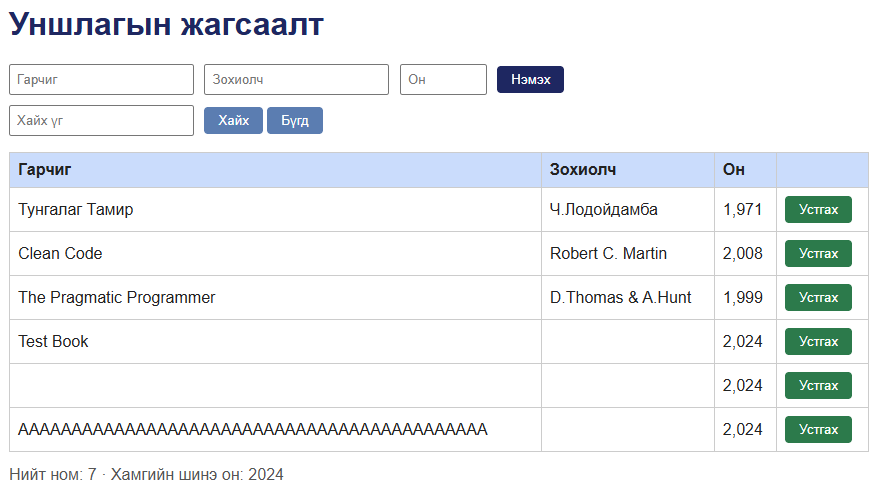

# BUG-01: Гарчгийг хоосон орхисон ч ном нэмэгддэг

Орчин: Уншлагын жагсаалт v2.0, Microsoft Edge 158.0.0.0, Windows, 2026-11-24
Урьдчилсан нөхцөл: `node app.js`-ийг шинээр асаасан; эхний 3 ном жагсаалтад байна.

## Дахин гаргах алхам

1. `http://localhost:3000`-ийг нээнэ.
2. `Гарчиг` талбарыг хоосон орхиж, `Зохиолч` талбарт `Test Author`, `Он` талбарт `2024` оруулна.
3. `Нэмэх` товчийг дарна.

Хүлээгдэж байсан: Гарчиг заавал бөглөгдөх ёстой; ном нэмэгдэхгүй, алдааны мессеж харагдана.

Бодит үр дүн: Хоосон гарчигтай мөр нэмэгдэж, “Ном нэмэгдлээ” мессеж гарна.

Ноцтой байдал: Major — гарчиггүй өгөгдөл номын жагсаалтад хадгалагдана.

Хавсралт: 
Олдсон аялал: Supermodel (GUI)
