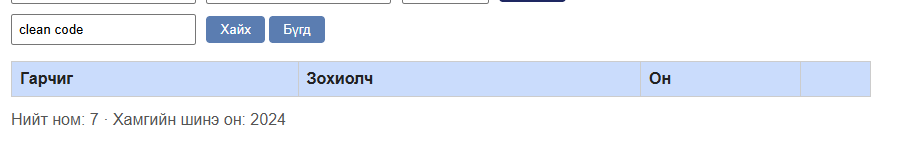

# BUG-03: Хайлт том, жижиг үсгийг ялгадаг

Орчин: Уншлагын жагсаалт v2.0, Microsoft Edge 158.0.0.0, Windows, 2026-11-24
Урьдчилсан нөхцөл: `node app.js`-ийг шинээр асаасан; эхний 3 номын дунд “Clean Code” байна.

## Дахин гаргах алхам

1. `http://localhost:3000`-ийг нээнэ.
2. `Хайх үг` талбарт `clean code` гэж жижиг үсгээр бичнэ.
3. `Хайх` товчийг дарна.

Хүлээгдэж байсан: Том/жижиг үсэг үл ялгах тул “Clean Code” номын мөр харагдана.

Бодит үр дүн: Хайлтын хүснэгтэд тохирох мөр гарахгүй.

Ноцтой байдал: Major — зөв хайлтын үг өгсөн ч хэрэглэгч номоо олж чадахгүй.

Хавсралт: 
Олдсон аялал: Supermodel (GUI)
